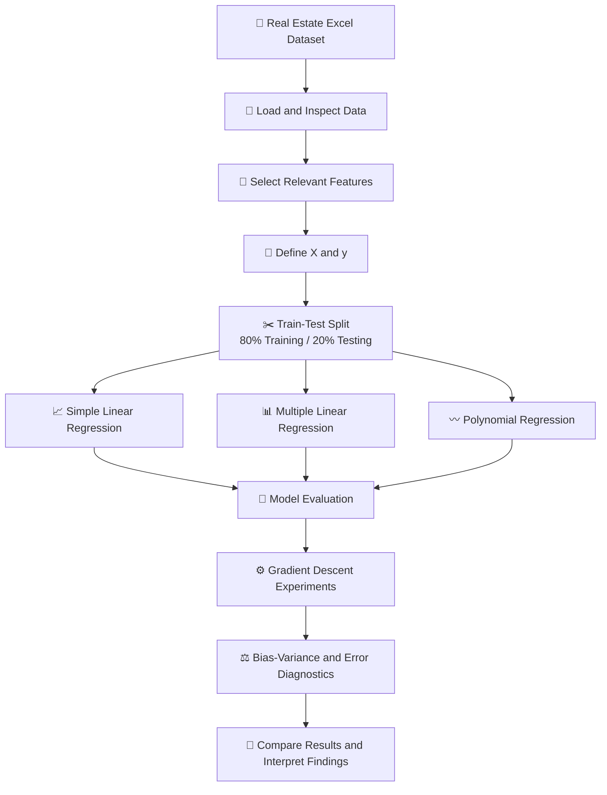
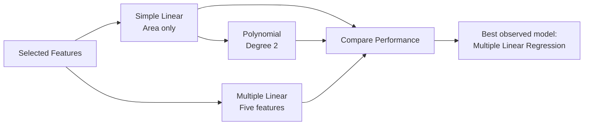
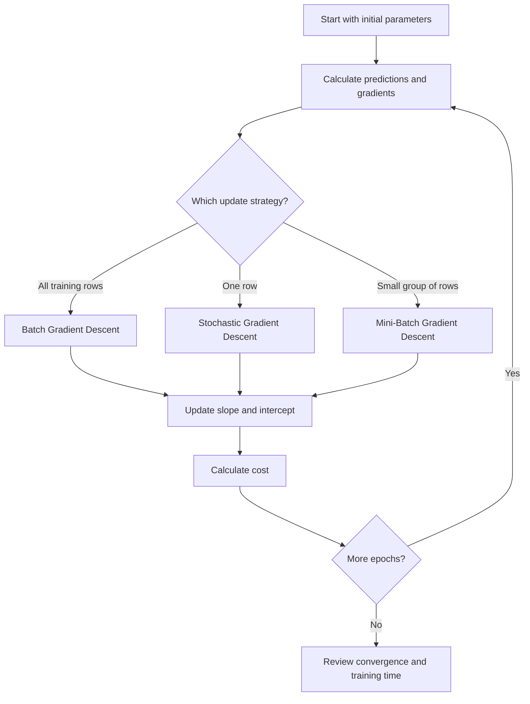

<div align="center">

# 🏠 Predictive Insight Engine

### Real Estate Price Prediction Using Supervised Machine Learning

**A practical regression project exploring how property characteristics influence estimated house prices.**

<br/>


</div>

---

## 📌 Table of Contents

- [👋 About the Project](#-about-the-project)
- [🎯 Project Objectives](#-project-objectives)
- [📊 Dataset Overview](#-dataset-overview)
- [🧰 Technology Stack](#-technology-stack)
- [🗺️ Project Workflow](#️-project-workflow)
- [🧠 Machine Learning Concepts Covered](#-machine-learning-concepts-covered)
- [🤖 Models Implemented](#-models-implemented)
- [📈 Model Performance](#-model-performance)
- [💻 Code Highlights](#-code-highlights)
- [📂 Project Structure](#-project-structure)
- [⚙️ Getting Started](#️-getting-started)
- [🔍 Key Findings and Business Interpretation](#-key-findings-and-business-interpretation)
- [⚠️ Limitations and Future Improvements](#️-limitations-and-future-improvements)
- [📚 Learning Outcomes](#-learning-outcomes)
- [👨‍💻 Author](#-author)

---

## 👋 About the Project

What makes one house more valuable than another? Is it simply the size of the property, or do bedrooms, bathrooms, location and property age also play an important role?

That is the question behind this project.

**Predictive Insight Engine** is a hands-on supervised machine learning project focused on predicting residential property prices using regression techniques. I started with a straightforward model using house area alone, then expanded the analysis to include multiple property characteristics. I also explored polynomial regression and implemented three Gradient Descent optimization approaches from scratch.

Rather than stopping at model training, I worked through the wider regression workflow: understanding the dataset, exploring relationships, splitting the data, evaluating predictions, inspecting residuals and comparing training and testing errors.

The project is designed to demonstrate both the practical implementation of regression models and an understanding of *why* one model performs better than another.

> 💡 **The central takeaway:** house area alone provides a useful starting point, but combining several relevant property characteristics produces substantially better predictions in this experiment.

## 🎯 Project Objectives

The project was built around the following objectives:

- Understand the fundamentals of supervised learning and regression.
- Explore a real estate dataset and identify relevant prediction features.
- Distinguish independent variables from the dependent variable.
- Build a Simple Linear Regression model using house area.
- Extend the analysis with Multiple Linear Regression.
- Explore non-linear relationships using Degree-2 Polynomial Regression.
- Evaluate models using MAE, MSE, RMSE, R² and Adjusted R².
- Examine regression residuals and key linear regression assumptions.
- Implement Batch, Stochastic and Mini-Batch Gradient Descent from scratch.
- Compare model errors to investigate bias, variance, overfitting and underfitting.
- Interpret the results in a practical property-pricing context.

## 📊 Dataset Overview

This project uses the **Real Estate House Price Dataset**, supplied as an Excel workbook.

| Dataset detail | Description |
|---|---|
| Records | 4,200 rows |
| Columns | 12 |
| File format | Excel (`.xlsx`) |
| Prediction target | `house_price_inr` |
| Selected input features | 5 |
| Problem type | Supervised learning |
| ML task | Regression |

### Dataset columns

The supplied dataset contains the following fields:

| Column | Description | Role in this project |
|---|---|---|
| `house_id` | Unique property identifier | Not used as a model feature |
| `area_sqft` | House area in square feet | Selected feature |
| `bedrooms` | Number of bedrooms | Selected feature |
| `bathrooms` | Number of bathrooms | Selected feature |
| `location_score` | Property location score | Selected feature |
| `age_years` | Age of the property in years | Selected feature |
| `distance_city_km` | Distance from the city | Not selected |
| `lot_size_sqft` | Plot size in square feet | Not selected |
| `has_garage` | Garage availability indicator | Not selected |
| `has_pool` | Swimming pool availability indicator | Not selected |
| `renovation_years_ago` | Years since renovation | Not selected |
| `house_price_inr` | House price in Indian rupees | **Target variable** |

### Features used for modelling

The notebook deliberately uses five selected features from the dataset:

```python
features = [
    'area_sqft',
    'bedrooms',
    'bathrooms',
    'location_score',
    'age_years'
]

target = 'house_price_inr'

X = df[features]
y = df[target]
```

- **Independent variables (X):** area, bedrooms, bathrooms, location score and property age.
- **Dependent variable (y):** house price in INR.

The remaining dataset columns are not included in the models developed in this notebook.

## 🧰 Technology Stack

| Tool / Library | How it is used |
|---|---|
| Python | Core programming language |
| Jupyter Notebook | Interactive project development |
| NumPy | Numerical operations and Gradient Descent calculations |
| Pandas | Loading, selecting and analysing tabular data |
| Matplotlib | Scatter plots, regression lines, residual plots and comparisons |
| Scikit-learn | Data splitting, regression models, preprocessing and evaluation |
| OpenPyXL | Excel workbook support for Pandas |

## 🗺️ Project Workflow

The project follows a structured machine learning workflow, moving from raw data to model comparison and interpretation.



### Model development at a glance



## 🧠 Machine Learning Concepts Covered

The notebook is organised into learning sections so the implementation connects with the underlying theory.

| Section | Topics explored |
|---|---|
| Part A – Conceptual Understanding | Supervised learning, regression vs classification, simple linear regression, assumptions, bias–variance, overfitting and underfitting |
| Part B – Dataset Understanding & Preparation | Loading data, feature selection, independent and dependent variables, visual exploration and train-test split |
| Part C – Simple Linear Regression | Model training, predictions, regression line, slope and intercept, residual inspection |
| Part D – Model Evaluation Metrics | MAE, MSE, RMSE, R² and Adjusted R² |
| Part E – Multiple Linear Regression | Multiple-feature modelling, coefficients and model comparison |
| Part F – Polynomial Regression | Degree-2 polynomial features, comparison with linear regression and overfitting checks |
| Part G – Gradient Descent Optimization | Batch, Stochastic and Mini-Batch Gradient Descent implemented manually |
| Part H – Bias–Variance & Model Diagnostics | Training/testing RMSE, generalization gap and model complexity |
| Part I – Final Analysis & Reporting | Final performance comparison and practical interpretation |

### Evaluation metrics

The notebook uses five metrics to evaluate the regression models:

- **MAE – Mean Absolute Error:** average absolute difference between actual and predicted values.
- **MSE – Mean Squared Error:** average squared prediction error.
- **RMSE – Root Mean Squared Error:** square root of MSE, expressed in the target's units.
- **R² Score:** indicates the proportion of target variance explained by the model.
- **Adjusted R²:** adjusts R² for the number of predictors used.

For MAE, RMSE and MSE, lower values indicate smaller prediction errors. For R² and Adjusted R², higher values generally indicate a better fit, while still needing to be interpreted in context.

## 🤖 Models Implemented

### 1. Simple Linear Regression

The first model uses only `area_sqft` to predict `house_price_inr`.

It provides a baseline and helps demonstrate the relationship between property size and price.

The basic equation is:

\[
y = mx + c
\]

Where:
- `y` is the predicted house price.
- `x` is house area.
- `m` is the slope.
- `c` is the intercept.

### 2. Multiple Linear Regression

The second model uses all five selected property features:

- `area_sqft`
- `bedrooms`
- `bathrooms`
- `location_score`
- `age_years`

This allows the model to consider several property characteristics together rather than relying on area alone.

### 3. Polynomial Regression

The third model uses a Degree-2 polynomial transformation of house area.

The aim is to explore whether a curved relationship between house area and price improves prediction performance.

The notebook uses `PolynomialFeatures(degree=2, include_bias=False)` followed by a Linear Regression estimator.

### 4. Gradient Descent — Implemented from Scratch

In addition to Scikit-learn model fitting, I implemented three optimization methods manually:

| Method | How the parameters are updated |
|---|---|
| Batch Gradient Descent | Uses the complete training dataset for each update |
| Stochastic Gradient Descent | Updates using one observation at a time |
| Mini-Batch Gradient Descent | Updates using small groups of observations |

For these experiments, the notebook standardizes the training house-area values and target values before applying the algorithms. The implementations use a learning rate, epochs and cost history to study convergence.



## 📈 Model Performance

The following values are taken from the saved outputs in the supplied notebook. They represent the notebook's recorded train/test experiment, not a guarantee of performance on new properties.

### Testing performance comparison

| Model | MAE (₹) | RMSE (₹) | R² Score | Adjusted R² |
|---|---:|---:|---:|---:|
| Simple Linear Regression | 6,294,593.70 | 8,184,696.70 | 0.5625 | 0.5620 |
| Multiple Linear Regression | 2,641,320.38 | 3,584,508.58 | **0.9161** | **0.9156** |
| Polynomial Regression (Degree 2) | 6,292,394.56 | 8,183,089.09 | 0.5627 | 0.5616 |

<details>
<summary>📋 View Mean Squared Error (MSE) results</summary>

| Model | MSE (₹²) |
|---|---:|
| Simple Linear Regression | 66,989,260,021,849.47 |
| Multiple Linear Regression | 12,848,701,729,036.90 |
| Polynomial Regression (Degree 2) | 66,962,947,122,198.46 |

</details>

### 🏆 Best-performing model: Multiple Linear Regression

Multiple Linear Regression achieved the strongest test results in this experiment:

- **R²:** approximately 0.9161.
- **Adjusted R²:** approximately 0.9156.
- **RMSE:** approximately ₹3.58 million.
- **MAE:** approximately ₹2.64 million.

Its R² score indicates that the model explains approximately 91.61% of the variation in house prices in the test data.

The two models using only house area performed considerably less well, with R² scores of approximately 0.563. Polynomial Regression produced only a very small improvement over Simple Linear Regression.

> 📌 **Important interpretation:** The results support using multiple relevant property features for this dataset. They do not establish that the model is ready for real-world property valuation or that its predictions are unbiased.

## 💻 Code Highlights

Here are a few representative examples from the notebook. They are included to make the repository easier to understand and to give visitors a quick look at the implementation.

### 1. Load the Excel dataset

```python
import numpy as np
import pandas as pd
import matplotlib.pyplot as plt

from sklearn.model_selection import train_test_split
from sklearn.linear_model import LinearRegression
from sklearn.preprocessing import PolynomialFeatures
from sklearn.metrics import (
    mean_absolute_error,
    mean_squared_error,
    r2_score
)

df = pd.read_excel("RealEstate_HousePrice_Dataset_4200.xlsx")

print(df.shape)
df.head()
```

### 2. Split the data into training and testing sets

```python
X_train, X_test, y_train, y_test = train_test_split(
    X,
    y,
    test_size=0.2,
    random_state=42
)
```

The split uses 80% of the data for training and 20% for testing. The fixed random state makes the split reproducible.

### 3. Train a Multiple Linear Regression model

```python
multiple_lr = LinearRegression()

multiple_lr.fit(X_train, y_train)

y_pred_multiple = multiple_lr.predict(X_test)
```

### 4. Evaluate the model

```python
mae = mean_absolute_error(y_test, y_pred_multiple)

mse = mean_squared_error(y_test, y_pred_multiple)

rmse = np.sqrt(mse)

r2 = r2_score(y_test, y_pred_multiple)

print("MAE:", mae)
print("MSE:", mse)
print("RMSE:", rmse)
print("R² Score:", r2)
```

### 5. Create Polynomial Features

```python
poly = PolynomialFeatures(
    degree=2,
    include_bias=False
)

X_poly_train = poly.fit_transform(X_simple_train)
X_poly_test = poly.transform(X_simple_test)

poly_lr = LinearRegression()

poly_lr.fit(X_poly_train, y_train)

y_pred_poly = poly_lr.predict(X_poly_test)
```

### 6. Implement Batch Gradient Descent

This is a shortened view of the manual optimization logic used in the notebook:

```python
def batch_gradient_descent(
    x,
    y,
    learning_rate=0.05,
    epochs=100
):
    m = 0
    c = 0

    n = len(x)
    cost_history = []

    for epoch in range(epochs):
        y_predicted = m * x + c

        mp = -(2 / n) * np.sum(
            x * (y - y_predicted)
        )

        cp = -(2 / n) * np.sum(
            y - y_predicted
        )

        m = m - learning_rate * mp
        c = c - learning_rate * cp

        cost = np.mean(
            (y - (m * x + c)) ** 2
        )

        cost_history.append(cost)

    return m, c, cost_history
```

The full notebook implementation also records training time and includes separate functions for Stochastic and Mini-Batch Gradient Descent.

## 📂 Project Structure

A clean GitHub repository for this project can be organised as follows:

```text
Predictive-Insight-Engine/
│
├── 📓 Predictive_Insight_Engine.ipynb
│
├── 📁 data/
│   └── RealEstate_HousePrice_Dataset_4200.xlsx
│
├── 📄 README.md
│
└── 📄 requirements.txt
```

**File descriptions**

| File | Purpose |
|---|---|
| `Predictive_Insight_Engine.ipynb` | Main notebook containing explanations, code, visualisations and model evaluation |
| `data/RealEstate_HousePrice_Dataset_4200.xlsx` | Excel dataset used by the notebook |
| `README.md` | Project overview and documentation |
| `requirements.txt` | Python dependencies |

The structure above is a recommended repository layout. The uploaded notebook and dataset are the supplied project files; create the `data` folder and `requirements.txt` if you adopt this layout.

## ⚙️ Getting Started

Follow these steps to run the project on your own machine.

### Prerequisites

- Python 3.9 or later recommended.
- Jupyter Notebook or JupyterLab.
- The supplied Excel dataset.

### 1. Clone the repository

```bash
git clone https://github.com/YOUR-USERNAME/Predictive-Insight-Engine.git

cd Predictive-Insight-Engine
```

Replace `YOUR-USERNAME` with your GitHub username and use the actual repository URL after publishing the project.

### 2. Create and activate a virtual environment (recommended)

```bash
python -m venv .venv
```

**Windows:**

```bash
.venv\Scripts\activate
```

**macOS / Linux:**

```bash
source .venv/bin/activate
```

### 3. Install the dependencies

Create a `requirements.txt` file containing:

```text
numpy
pandas
matplotlib
scikit-learn
openpyxl
jupyter
```

Then install the packages:

```bash
pip install -r requirements.txt
```

### 4. Arrange the project files

If you use the recommended folder structure, place the Excel workbook inside `data/`.

The notebook currently loads the dataset with this filename:

```python
df = pd.read_excel("RealEstate_HousePrice_Dataset_4200.xlsx")
```

To run it from the project root with the recommended `data/` folder, update that line to:

```python
df = pd.read_excel(
    "data/RealEstate_HousePrice_Dataset_4200.xlsx"
)
```

**Filename note:** The uploaded workbook in this project conversation has a download filename ending in `(5).xlsx`. Rename it to `RealEstate_HousePrice_Dataset_4200.xlsx` when following the commands above, or update the notebook path to match your actual filename.

### 5. Launch Jupyter Notebook

```bash
jupyter notebook
```

Open `Predictive_Insight_Engine.ipynb` and run the cells from top to bottom.

> ✅ Running the notebook in order is important because later sections use variables and models created in earlier cells.

## 🔍 Key Findings and Business Interpretation

### 1. House area alone is not enough

Simple Linear Regression provides a useful baseline, but its test R² score is approximately 0.563. House size by itself does not capture all the information used by the stronger model.

### 2. Multiple property features improve prediction

Using area, bedrooms, bathrooms, location score and property age together produces a much stronger result in this experiment. The Multiple Linear Regression model reaches an R² score of approximately 0.916.

### 3. Polynomial complexity did not meaningfully improve the one-feature model

Adding a squared area term produces only a marginal change in RMSE and R². In this experiment, that additional curve does not solve the limitation of relying on one feature.

### 4. Gradient Descent illustrates different optimization strategies

The three manually implemented methods demonstrate how the amount of data used for each parameter update changes the optimization process. Their cost histories and recorded training times provide a practical comparison.

### 5. Training and testing errors help diagnose model behaviour

The notebook compares training and testing RMSE and calculates a generalization gap. This provides a practical diagnostic for model fit, although it is not a formal mathematical bias–variance decomposition.

### What could this mean in a business setting?

For a property marketplace or real estate analysis team, the experiment suggests that a more informative set of property attributes can support better price estimates than floor area alone.

A model like this could be a starting point for:
- Exploring the relationship between property attributes and asking prices.
- Building an initial property-price estimation prototype.
- Supporting exploratory analysis for real estate datasets.
- Identifying which additional data sources may improve a future pricing model.

These are potential applications, not validated production uses of the current notebook.

## ⚠️ Limitations and Future Improvements

A good project should be clear about what it has and has not established.

### Current limitations

- Only five of the twelve available dataset columns are used for modelling.
- The notebook evaluates one train-test split rather than reporting cross-validation results.
- Simple and Polynomial Regression use only house area, so their results are not directly equivalent in feature information to the five-feature Multiple Linear Regression model.
- The Gradient Descent experiments use standardized house area and target values; they are separate optimization demonstrations rather than a replacement for the fitted five-feature model.
- The notebook's training/testing error comparison is a practical diagnostic, not a formal bias–variance decomposition.
- The notebook does not establish performance on an independent external dataset or validate the model for real property transactions.
- No hyperparameter search or systematic feature-selection experiment is reported.

### Possible next steps

If I extend this project, I would consider:

- Testing the unused dataset fields, such as distance to city, lot size, garage and pool availability, and renovation history.
- Using cross-validation to check whether performance is stable across different splits.
- Comparing Linear Regression with Ridge, Lasso, Decision Tree and Random Forest regression.
- Checking multicollinearity and examining residual patterns in greater depth.
- Evaluating prediction errors across different property price ranges and locations.
- Saving the fitted model and building a simple interface for entering property details and generating estimates.
- Testing the final model on new, unseen data before considering any practical deployment.

## 📚 Learning Outcomes

Working through this project helped me connect regression theory with an end-to-end practical workflow.

The main areas covered include:

- Preparing a dataset for supervised learning.
- Selecting input features and defining a target variable.
- Training and testing regression models.
- Understanding regression coefficients, slope and intercept.
- Comparing model performance using multiple evaluation metrics.
- Visualising relationships and inspecting residuals.
- Creating polynomial features with Scikit-learn.
- Implementing optimization algorithms using NumPy.
- Comparing training and testing errors.
- Communicating model results in a practical context.

Most importantly, this project reinforced that a model should not be judged by a single score alone. Understanding the data, the features, the errors and the limitations is just as important as fitting the model.

---

## 👨‍💻 Author

<div align="center">

### **Dushyant V**

*Aspiring Data Scientist | Machine Learning & Data Analytics*

I enjoy learning by building practical projects and turning theoretical concepts into working solutions. This project reflects my exploration of supervised learning, regression modelling, model evaluation and optimization techniques using Python.

**Thanks for taking the time to explore my project!** ⭐

</div>

---

<div align="center">

If you found this project useful or interesting, feel free to ⭐ the repository.

**Built with curiosity, Python and a passion for learning.** 🚀

</div>
